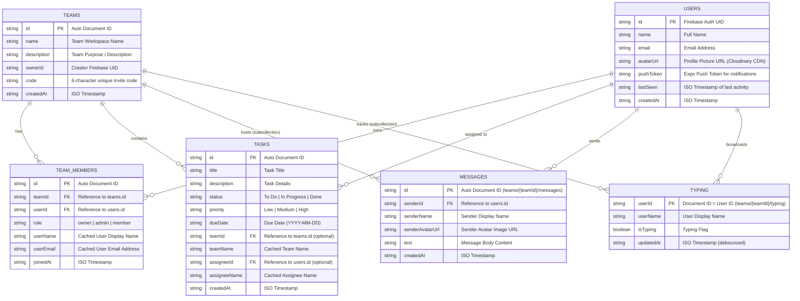

# 📱 Task Management App (React Native & Firebase)

> **Practical Exam 2 – Mobile Application Development**
> A collaborative Task Management mobile application built with **React Native (Expo)**, **Firebase Authentication**, **Cloud Firestore**, and **Real-Time Team Chat**.

---

## 🚀 Overview & Features

### 1. Firebase Authentication & Route Protection
- **Email & Password Authentication**: Full Sign Up and Login flows with form validation and friendly error handling.
- **Session Persistence**: Session persists across app restarts using `@react-native-async-storage/async-storage` and Firebase Auth listeners.
- **Route Guard**: Unauthenticated users are redirected to the Login screen; authenticated users access Home, Teams, and Chat.
- **Profile & Logout**: Displays user info, avatar initials, and sign out with confirmation.

### 2. Team Workspaces & Collaboration
- **Create Teams**: Create workspaces with automatic 6-character invite codes (e.g. `AB12CD`).
- **Join Teams**: Join existing workspaces instantly using the invite code.
- **Team Detail Screen**: Inspect members list (name, email, role) and tasks assigned to the team.
- **Shareable Codes**: One-tap native sharing of team invite codes.

### 3. Task Assignment & Team Linking
- **Team & Assignee Selectors**: Assign tasks to a specific team and choose an assignee from the team's member list.
- **Visual Indicators**: Task cards display team badges and assignee chips.
- **Smart Filtering**: Home screen displays tasks belonging to the user's teams and personal tasks.

### 4. Real-Time Team Chat
- **Subcollection Storage**: Messages stored under `teams/{teamId}/messages`.
- **Live Sync**: Uses Firestore `onSnapshot` listener for instant message delivery without manual refresh.
- **Modern Chat Bubble UI**:
  - Current user's messages on the right (primary color, white text).
  - Teammates' messages on the left (light card, sender avatar & name).
  - Precise timestamps (`HH:mm`) and auto-scroll to latest message.

### 5. Production Security Rules
- Protected Firestore Security Rules enforcing `request.auth != null` for read and write operations across all collections.

### 🌟 Bonus & Optional Features (Completed)
- **Google Sign-In**: Alternative authentication provider via OAuth 2.0 with custom Google sign-in button and fallback demo mode.
- **Profile Picture & Cloudinary Media**: Camera roll image picker via `expo-image-picker`, automated upload to Cloudinary CDN (Free tier, no credit card required), profile updating in Firestore, and display of avatars in Profile and alongside chat messages.
- **Typing Indicator & Online Status**: Real-time broadcast and debounced listener for typing members in `teams/{teamId}/typing`, with animated dots in chat and status in header.
- **Push & Local Notifications**: Automated notifications via `expo-notifications` whenever a task is assigned to an assignee and when team messages are dispatched.
- **Complete ERD & Data Dictionary**: Exhaustive Mermaid diagram and schema table documenting all collections, subcollections, relations, foreign keys, and fields.

---

## 📊 Database Schema & ERD (Entity Relationship Diagram)



### 📋 Firestore Collections & Data Dictionary

| Collection / Subcollection | Path | Key Fields & Types | Purpose & Description |
|:---|:---|:---|:---|
| **users** | `/users/{userId}` | `id` (string), `name` (string), `email` (string), `avatarUrl` (string?), `pushToken` (string?), `lastSeen` (string?), `createdAt` (string) | Stores user identity, Cloudinary CDN avatar URL, Expo push token, and online activity status. |
| **teams** | `/teams/{teamId}` | `id` (string), `name` (string), `description` (string), `ownerId` (string), `code` (string), `createdAt` (string) | Team workspaces and collaboration hubs with 6-char invite codes. |
| **teamMembers** | `/teamMembers/{memberId}` | `id` (string), `teamId` (string), `userId` (string), `role` (string), `userName` (string), `userEmail` (string), `joinedAt` (string) | Relational mapping connecting users to teams with roles (`owner`, `admin`, `member`). |
| **tasks** | `/tasks/{taskId}` | `id` (string), `title` (string), `description` (string), `status` (string), `priority` (string), `dueDate` (string?), `teamId` (string?), `assigneeId` (string?), `createdAt` (string) | Collaborative task tracking with team association and member assignment. |
| **messages** | `/teams/{teamId}/messages/{messageId}` | `id` (string), `senderId` (string), `senderName` (string), `senderAvatarUrl` (string?), `text` (string), `createdAt` (string) | Real-time chat stream with Firestore `onSnapshot` listeners and sender profile avatars. |
| **typing** | `/teams/{teamId}/typing/{userId}` | `userId` (string), `userName` (string), `isTyping` (boolean), `updatedAt` (string) | Ephemeral real-time typing indicator broadcast across team members. |


---

## 🗂️ Project Architecture & Folder Structure

```
task-management-app-native/
├── .github/
│   └── workflows/
│       └── ci.yml               # GitHub Actions CI for lint & type checking
├── assets/                      # Application icons & splash assets
├── firestore.rules              # Production Firestore Security Rules
├── src/
│   ├── components/              # Reusable UI components
│   │   ├── EmptyState.tsx       # Placeholder when no tasks exist
│   │   ├── Header.tsx           # App header & Firebase connection indicator
│   │   ├── StatusFilter.tsx     # Status filter chips with live counts
│   │   ├── TaskCard.tsx         # Task card item with badges, team/assignee tags
│   │   └── TaskModal.tsx        # Modal form with Team and Assignee selectors
│   ├── constants/
│   │   └── theme.ts             # Theme colors, tokens, and options
│   ├── context/
│   │   └── AuthContext.tsx      # Global Auth state provider & useAuth hook
│   ├── hooks/
│   │   └── useTasks.ts          # Custom hook for task state & operations
│   ├── navigation/
│   │   └── AppNavigator.tsx     # Auth-aware stack & bottom tab navigator
│   ├── screens/
│   │   ├── ChatScreen.tsx       # Real-time team messaging screen
│   │   ├── HomeScreen.tsx       # Team-filtered task list & CRUD
│   │   ├── LoginScreen.tsx      # Firebase Auth login screen
│   │   ├── ProfileScreen.tsx    # User profile & logout screen
│   │   ├── SignUpScreen.tsx     # Firebase Auth registration screen
│   │   ├── TeamDetailScreen.tsx # Team workspace, members & team tasks
│   │   └── TeamsScreen.tsx      # Teams list, create & join by code
│   ├── services/
│   │   ├── authService.ts       # Firebase Auth (sign up, login, logout, profile)
│   │   ├── chatService.ts       # Real-time chat (onSnapshot, addDoc)
│   │   ├── firebase.ts          # Firebase SDK initialization with AsyncStorage persistence
│   │   ├── taskService.ts       # Firestore task CRUD & team queries
│   │   └── teamService.ts       # Team workspace creation, invite codes, membership
│   └── types/
│       ├── auth.ts              # UserProfile & Auth input types
│       ├── chat.ts              # ChatMessage & SendMessageInput types
│       ├── task.ts              # Task, Status, Priority & CRUD input types
│       └── team.ts              # Team, TeamMember & TeamRole types
├── .env.example                 # Example environment variables template
├── .gitignore                   # Git ignore file (excludes secrets, build artifacts)
├── .prettierrc                  # Prettier code formatting rules
├── eslint.config.js             # ESLint configuration with Expo & Prettier plugins
├── App.tsx                      # Root component wrapped with AuthProvider
├── app.json                     # Expo configuration
├── package.json                 # Project dependencies & npm scripts
└── tsconfig.json                # TypeScript compiler configuration
```

---

## 🛠️ Getting Started & Setup

### 1. Prerequisites
- Node.js (v20+ recommended)
- Expo CLI / Expo Go app on a physical device or emulator

### 2. Installation
```bash
npm install
```

### 3. Firebase Configuration
Create a `.env` file in the project root:
```env
EXPO_PUBLIC_FIREBASE_API_KEY=your_api_key
EXPO_PUBLIC_FIREBASE_AUTH_DOMAIN=your_project.firebaseapp.com
EXPO_PUBLIC_FIREBASE_PROJECT_ID=your_project_id
EXPO_PUBLIC_FIREBASE_STORAGE_BUCKET=your_project.appspot.com
EXPO_PUBLIC_FIREBASE_MESSAGING_SENDER_ID=your_sender_id
EXPO_PUBLIC_FIREBASE_APP_ID=your_app_id
EXPO_PUBLIC_FIREBASE_MEASUREMENT_ID=your_measurement_id
```

### 4. Running Locally
```bash
npm start
```
Scan the QR code with Expo Go on Android or iOS.

---

## 🧪 Verification & Quality Checks

Run lint and TypeScript checks before pushing:
```bash
npm run typecheck    # tsc --noEmit
npm run lint         # expo lint
```
